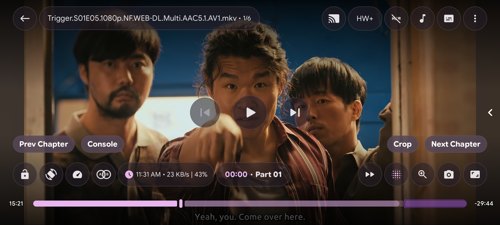
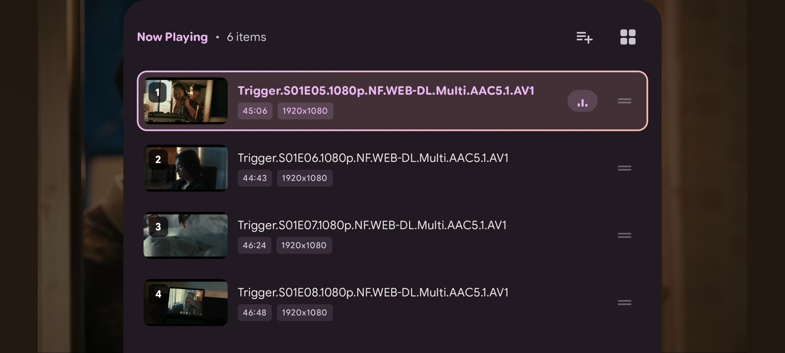
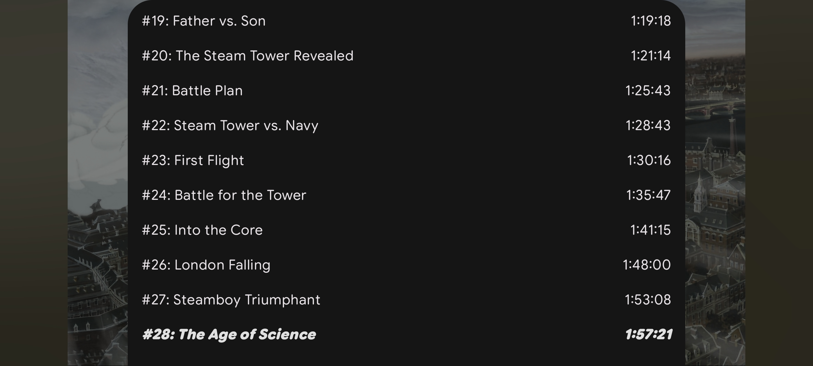
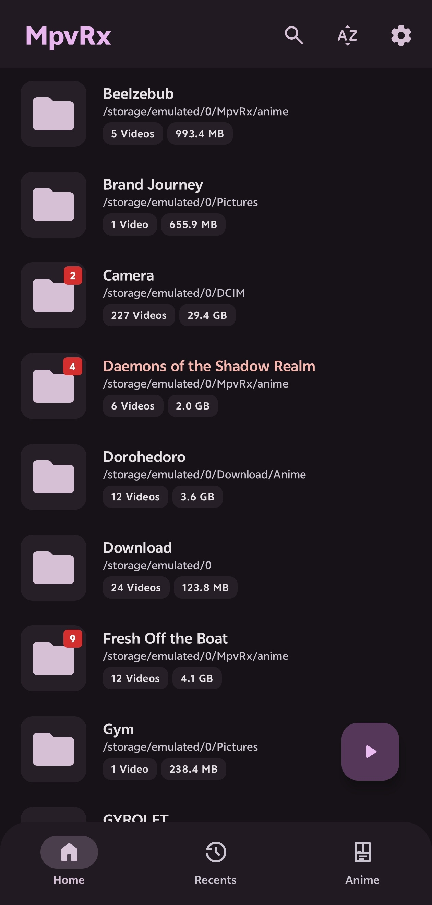
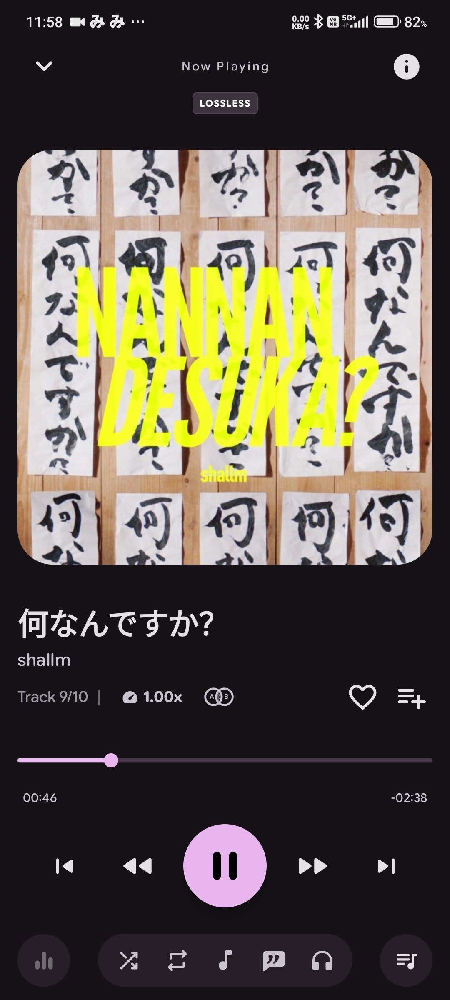
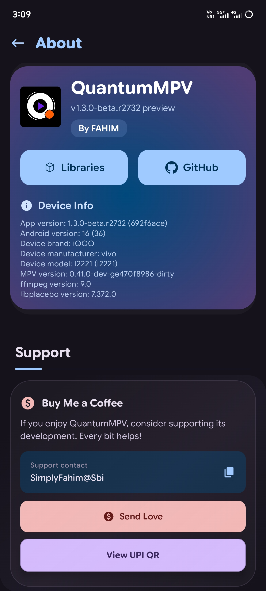

<div align="center">


# QuantumMPV

**A powerful, feature-rich Android media player built on libmpv.**<br>
HDR, shaders, Anime4K, smart subtitles, Cast and deep customization. No ads. No trackers.

[](#-download)
[](LICENSE)
[](https://github.com/Fahimofficial/QuantumMPV/releases/latest)
[](https://github.com/Fahimofficial/QuantumMPV/stargazers)

[Website](https://quantummpv.vercel.app/) · [Download](#-download) · [Features](#-features) · [Build](#-build-from-source) · [Credits](#-credits) · [Contact](#-contact) · [Support](#-support-the-project)

</div>

---

## ✨ Features

- 🎬 **mpv at the core.** libmpv playback with Vulkan or OpenGL rendering, `mpv.conf` / `input.conf` editors, mpv profiles, and Lua and JavaScript scripts with a built-in code editor.
- 🌈 **HDR and shaders.** An [hdr-toys](https://github.com/natural-harmonia-gropius/hdr-toys) tone-mapping pipeline (PQ, HLG, BT.2020), GPU debanding, ambient glow, video filter presets and automatic black-bar cropping.
- 🧩 **Anime4K upscaling.** Built-in quality presets with a 4K/8K guard and thermal-aware downgrading.
- 💬 **Subtitles.** Dual subtitles, full styling, online search (Wyzie and SubtitleHub), a font manager, and AI translation or speech-to-subtitle generation with your own provider key (OpenAI, Anthropic, Groq, OpenRouter, Together, OpenCode).
- 🖐️ **Gestures and controls.** Configurable double-tap zones, swipe seek, long-press speed, pinch zoom, volume boost, and a fully customizable control layout with your own buttons.
- 🎵 **Music.** Local library, now-playing view, LRCLIB lyrics, an equalizer and audio visualizers, plus Jellyfin, Navidrome/Subsonic and Audiobookshelf.
- 🌐 **Network and streaming.** SMB, FTP, SFTP and WebDAV, Jellyfin, Syncplay rooms, yt-dlp streaming and downloads, and magnet/torrent streaming.
- 📺 **Google Cast** with local-file casting, picture-in-picture, background playback and a sleep timer.
- 🎨 **Make it yours.** 30+ color themes including Material You and AMOLED black, a custom theme editor, wallpapers and Material 3 Expressive motion.
- 🔒 **Private by design.** No analytics or ads, a PIN/biometric secure folder, and crash reports that stay on your device.

<details>
<summary><b>🔋 Battery tips</b></summary>

- Start with an empty `mpv.conf` and the built-in `fast` profile.
- Prefer the `gpu` renderer over `gpu-next`, and try OpenGL before Vulkan.
- Shaders (Anime4K, ambient, HDR toys) run on every frame. Turn them off when you don't need them.
- The stats overlay (page 6) shows live battery draw, so you can see what a setting costs.

</details>

## 📸 Screenshots

<div align="center">
  
  <br><br>
  
  
  <br><br>
  
  
  
  
</div>

## 📥 Download

Get the latest APK from [GitHub Releases](https://github.com/Fahimofficial/QuantumMPV/releases/latest). Android 8.0 (API 26) or newer is required. Each release includes a `QuantumMPV-<tag>-SHA256SUMS.txt` checksum file.

| APK | Choose it when |
|---|---|
| `QuantumMPV-arm64-v8a` | You have a modern phone (most devices) |
| `QuantumMPV-armeabi-v7a` | You have an older 32-bit ARM device |
| `QuantumMPV-x86_64` / `QuantumMPV-x86` | You use an Intel/AMD device or an emulator |
| `QuantumMPV-universal` | You're unsure (works everywhere, larger download) |
| `QuantumMPV-no-vulkan` | Your GPU has Vulkan problems (OpenGL only, universal) |
| `QuantumMPV-fongmi` | You want the alternate mpv build with MediaCodec-Vulkan (universal) |

Pre-release builds are marked as such on the Releases page. The app can check GitHub for updates in **Settings → About**.

## 🔨 Build from source

**Requirements:** JDK 17, Android SDK platform 37, NDK `27.3.13750724`, CMake `3.22.1`, Python 3 and Git.

```bash
git clone https://github.com/Fahimofficial/QuantumMPV.git
cd QuantumMPV

python3 tools/verify_native_artifacts.py --download   # fetch the pinned, checksum-verified mpv AARs
./gradlew :app:assembleStandardDebug                  # APK in app/build/outputs/apk/standard/debug/
./gradlew :app:testStandardDebugUnitTest              # unit tests
```

| Flavor | Renderer | Native library |
|---|---|---|
| `standard` | Vulkan + OpenGL | `mpvlib` (FFmpeg 9.0) |
| `noVulkan` | OpenGL only | `mpvlib-no-vulkan` (FFmpeg 9.0) |
| `fongmi` | Vulkan + MediaCodec-Vulkan | `mpvlib-fongmi` |

Release builds, signing and the store pipeline are covered in [docs/RELEASE.md](docs/RELEASE.md) and [docs/CI_CD.md](docs/CI_CD.md). Want to contribute? Read [CONTRIBUTING.md](CONTRIBUTING.md) first.

## 🧰 Tech stack

| Area | Technology |
|---|---|
| Language | Kotlin 2.4 (JVM 17), C/C++ via NDK |
| UI | Jetpack Compose, Material 3 Expressive, Navigation 3, Haze |
| Playback | libmpv ([mpvlibAndroid](https://github.com/Riteshp2001/mpvlibAndroid)), FFmpeg, libplacebo, Media3 |
| Data | Room, kotlinx.serialization |
| DI | Koin |
| Networking | OkHttp, smbj, Apache Commons Net, JSch, Sardine, NanoHTTPD, libtorrent4j |
| Other | Google Cast, WorkManager, ZXing, Sora Editor, QuickJS-NG |
| Build | Gradle 9.8, AGP 9.5, KSP, Baseline Profiles |

## 🙏 Credits

QuantumMPV is an independent continuation of [**mpvRx**](https://github.com/Riteshp2001/mpvRx) by Ritesh Pandit, maintained by **FAHIM**. It stands on the work of these projects:

- [**mpv**](https://github.com/mpv-player/mpv), the media player engine behind everything here
- [**mpv-android**](https://github.com/mpv-android/mpv-android), [**mpvKt**](https://github.com/abdallahmehiz/mpvKt), [**mpvEx**](https://github.com/marlboro-advance/mpvEx) and [**MpvRex**](https://github.com/sfsakhawat999/mpvRex), the Android players this lineage grew from
- [**mpvlibAndroid**](https://github.com/Riteshp2001/mpvlibAndroid) for the prebuilt libmpv libraries
- [**hdr-toys**](https://github.com/natural-harmonia-gropius/hdr-toys), [**Anime4K**](https://github.com/bloc97/Anime4K) and [**ArtCNN**](https://github.com/Artoriuz/ArtCNN) for shaders
- [**FFmpeg**](https://ffmpeg.org/), [**libplacebo**](https://code.videolan.org/videolan/libplacebo), [**yt-dlp**](https://github.com/yt-dlp/yt-dlp) and [**libtorrent4j**](https://github.com/aldenml/libtorrent4j)
- [SunnyVishnu3](https://github.com/SunnyVishnu3) for the yt-dlp native integration

The complete list of projects, libraries, services and contributors is in [CITATION.md](CITATION.md) and on the [contributors page](https://github.com/Fahimofficial/QuantumMPV/graphs/contributors).

## 📄 License

QuantumMPV is free software under the [GNU Affero General Public License v3.0 or later](LICENSE). Third-party components keep their own licenses.

## 📬 Contact

<div align="center">

<a href="https://instagram.com/SimplyFahimofficial"></a>
<a href="mailto:simplyfahimofficial@gmail.com"></a>
<br>
<a href="https://SimplyFahim.pages.dev"></a>
<a href="https://github.com/Fahimofficial"></a>

</div>

---

<div align="center">

## 💚 Support the Project

QuantumMPV is free and always will be. If it makes your movie nights better, a small donation keeps development going.

<a href="https://quantummpv.vercel.app/pay/"></a>

### 👆 **Tap the QR to open UPI payment options**

<table>
<tr>
<td align="center">

**Payee:** Md Fahim<br>
**UPI ID**

```
SimplyFahim@sbi
```

</td>
</tr>
</table>

<a href="https://quantummpv.vercel.app/pay/"></a>
&nbsp;
<a href="https://ko-fi.com/simplyfahim"></a>

<sub>You choose the amount. Check that your UPI app shows <b>Md Fahim</b> before you pay.</sub>

</div>
